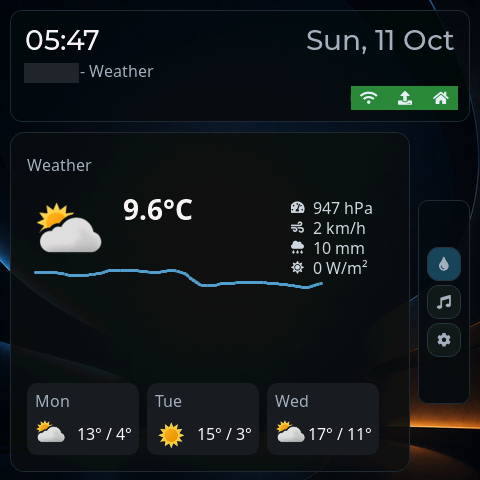
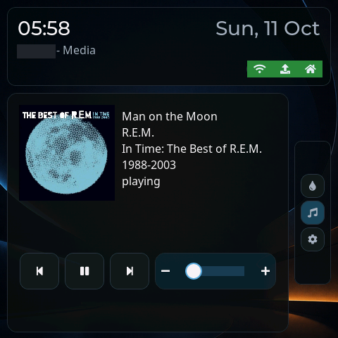
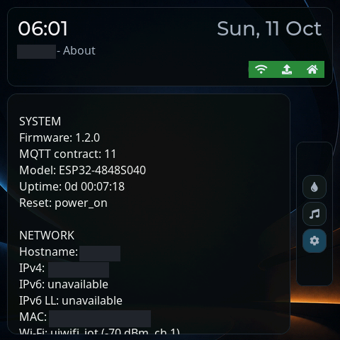

# Guition Wall Panel Firmware

Firmware for the ESP32-4848S040 wall panel, built with ESP-IDF, LVGL, MQTT, and Home Assistant MQTT Discovery. It shows time, weather, media, and an About page with live device and network diagnostics, optional measurement chips, a configurable sequence of weather, media, buttons, and About pages, and up to five footer buttons; supports display dimming, HTTPS OTA with rollback, diagnostics, and screenshots.

## Panel screenshots

Actual panel captures with only the device name and IP/MAC identifiers redacted; page names and layout are preserved. See the [screenshot gallery](docs/screenshots/README.md) for full-size images and capture instructions.

| Weather | Media | About |
| --- | --- | --- |
|  |  |  |

## Install a precompiled release (normal users)

Signed firmware releases are published on the [Forgejo releases page](https://git.baer.one/phbaer/walldisplay/releases). A normal user does not need ESP-IDF or this source tree to flash a release:

1. Confirm that the panel is an ESP32-S3 Guition ESP32-4848S040 with 16 MB flash, and connect its USB port. Use a data-capable USB cable.
2. Open the release you want and download `walldisplay-<version>-factory.bin` for normal factory flashing and `walldisplay-<version>.bin` for signed OTA updates. The release also includes `walldisplay-<version>-factory.tar.gz` with the individual partition files for advanced recovery or selective flashing.
3. Install Espressif's `esptool` in a temporary Python environment:

   ```sh
   python -m venv /tmp/walldisplay-esptool
   /tmp/walldisplay-esptool/bin/pip install esptool
   ```

4. Replace `<PORT>` with the panel's serial device (`/dev/ttyUSB0`, `/dev/ttyACM0`, or the corresponding Windows COM port), then flash the complete factory image at offset zero:

   ```sh
   /tmp/walldisplay-esptool/bin/esptool \
     --chip esp32s3 --port <PORT> write-flash \
     --flash-mode dio --flash-size keep --flash-freq 80m \
     0x0000 walldisplay-<version>-factory.bin
   ```

   A factory flash replaces the firmware partitions but does not create Wi-Fi or MQTT credentials. After reboot, continue with [Initial setup](#initial-setup) and [Home Assistant](#home-assistant).

The public CI artifacts are signed and can be configured on first boot through the local setup AP. Existing panels that already have a trusted signed baseline can use the application-only `.bin` through the integration's Repairs update flow. Before advertising a generic factory image as production-ready, run the [SoftAP provisioning acceptance procedure](docs/acceptance/softap-provisioning.md); the provisioning design is captured in the [SoftAP provisioning handover](docs/plans/softap-provisioning-handover.md).

For advanced recovery, unpack the factory archive and flash its individual files at the offsets in `partitions.csv`; the current layout uses bootloader `0x0000`, partition table `0x8000`, OTA data `0x14000`, and application `0x30000`. The merged factory image is the recommended normal-user path.

## Build and configuration

Install ESP-IDF 6.0.x. Release and CI builds use the `espressif/idf:v6.0.3` container; local builds were last verified with 6.0.2, the version recorded in `dependencies.lock`. Adjust the path below to your installed version, then configure and flash:

```sh
source "$HOME/.espressif/v6.0.2/esp-idf/export.sh"
cp config/panel_config.example.yaml config/panel_config.yaml
# Edit Wi-Fi, MQTT, discovery, and the base topic.
idf.py set-target esp32s3
idf.py build
idf.py -p <PORT> flash monitor
```

There are two supported deployment modes:

* **Preconfigured deployment:** put the target Wi-Fi and MQTT values in
  `config/panel_config.yaml` before building. These values are compiled into
  the firmware as defaults, so a new device can connect immediately even when
  its `appcfg` and runtime `nvs` partitions are blank. Provisioned values saved
  later take precedence over those defaults.
* **Generic factory/provisioning deployment:** build with the example or an
  otherwise non-credentialed `panel_config.yaml`, and ship blank `appcfg` and
  runtime `nvs` partitions. With no valid stored credentials the device starts
  its setup access point and the user completes configuration through the
  portal. Do not include a customer Wi-Fi password, MQTT secret, or screenshot
  token in this image.

The partitions are deliberately separate: `appcfg` is the factory/provisioning
NVS area and writable runtime `nvs` stores user overrides. Erasing only one can
leave the other source of settings intact. Give each panel a distinct base
topic, such as `panel/guition-4848s040-kitchen`. Changing the discovered
**Panel MQTT Topic** entity persists the new topic and restarts the panel;
update the matching Home Assistant configuration to publish to the new topic.

## IPv4 and IPv6 networking

The station supports dual-stack Wi-Fi and IPv6-only networks using SLAAC.
Routers on IPv6-only networks must advertise an autonomous IPv6 prefix and DNS
servers through Router Advertisement RDNSS; stateful DHCPv6 address assignment
and DHCPv6-only DNS provisioning are not supported by this firmware. No
static IPv6 configuration is required. Existing development workspaces with an
older generated `sdkconfig` must enable the IPv6/SLAAC/RDNSS settings in
`idf.py menuconfig` or regenerate that file from `sdkconfig.defaults`; fresh
release builds use the committed defaults. The setup AP and captive DNS remain
IPv4 at `192.168.4.1`.

Startup and portal Wi-Fi validation accept either an IPv4 address or a preferred
IPv6 ULA/global address. A link-local address alone does not complete validation.
If Wi-Fi or router advertisements arrive after the initial 15-second boot wait,
a background worker starts MQTT once the station is ready. Disconnects and
address expiry are reflected by live interface queries rather than a latched
connection flag. The About page and `state/device.ipv6_global` show a preferred
ULA address when present, otherwise a global address; the existing field name is
retained. `ipv6_linklocal` remains a separate diagnostic.

MQTT, artwork HTTP(S), and signed OTA prefer IPv4 when the station has IPv4,
otherwise IPv6. A connection attempt that never connects moves the next attempt
to the other family: HTTP clients retry immediately, MQTT on its next
reconnect. The family that last connected is remembered and tried first, so a
dropped MQTT session reconnects over the family that worked and later OTA range
requests do not wait for a dead family again. A remembered family is ignored
once the station no longer has an address of that family. IPv4 literals and
bracketed IPv6 literals use only their own family.
The portal MQTT test allows up to 30 seconds for two connection attempts and
fails immediately on broker rejection. IPv6 literals in URIs must use brackets,
for example `mqtts://[fd12:3456:789a::10]:8883`; DNS hostnames matching TLS
certificates are recommended. TLS policy, CA verification, and hostname
verification are identical for both families. HTTP fallback does not restart a
partially downloaded body or bypass HTTP status, image, or firmware validation.
Address-family fallback is sequential, not simultaneous connection racing;
servers with IPv4-only addresses still require IPv4 connectivity (or suitable
network translation) from an IPv6-only panel. Setting a panel hostname does
not advertise an mDNS service; DNS naming remains a network responsibility.

Screenshot status URLs prefer IPv4, otherwise a bracketed ULA/global IPv6 host.
For direct downloads use `http://[<ipv6-address>]:8080/screenshot.bmp` with the
usual bearer token. The Home Assistant preview proxy retains its private LAN
address policy; see [Home Assistant screenshot previews](docs/reference/mqtt-contract.md#screenshot-preview-in-home-assistant).
Both MQTT Sync and the custom integration use the same topics and network
behavior; the blueprint continues to use a passive integration companion for
image previews. Matter support is not included.

See the [IPv6 implementation and acceptance notes](docs/plans/ipv6.md) for the
fixed release selection and hardware verification matrix.

## Initial setup

The setup portal tests the submitted Wi-Fi credentials before writing them to
NVS. A failed association returns an error and restores the previously active
station configuration, so a typo cannot replace a working network. MQTT
settings remain optional during this step; MQTT connectivity is checked after
the panel reconnects and can be configured later from the portal.
Open Wi-Fi networks are supported; the saved station authentication threshold
matches whether a password was provided.

1. **Prepare the panel and network.** Connect the panel's USB port, identify its serial port, and make sure it can reach the MQTT broker over the configured network. The target is the ESP32-S3 480×480 panel with 16 MB flash and octal PSRAM.
2. **Create the build configuration.** Copy `config/panel_config.example.yaml` to `config/panel_config.yaml` and set the Wi-Fi SSID/password, MQTTS broker URI, broker credentials, Home Assistant discovery prefix, and a unique `homeassistant.base_topic`. Keep `mqtt.require_tls: true` unless the broker is on an isolated trusted LAN; use a CA PEM in `config/` when the broker certificate is not in the ESP-IDF bundle. Set the initial page layout under `display`. Keep local configuration files out of version control.
3. **Flash a baseline.** With ESP-IDF 6.0.x activated, run:

   ```sh
   idf.py set-target esp32s3
   idf.py build
   idf.py -p <PORT> flash monitor
   ```

   This produces an unsigned development image. It is suitable for first bring-up and local testing, but it rejects remote OTA requests. For OTA, flash a signed factory image from a Forgejo release, or build and sign one locally with the RSA-3072 key described in [Security and upgrading to 1.0.0](docs/how-to/security-and-signing.md). A signed baseline must be installed before later signed OTA updates can be accepted.
4. **Finish Home Assistant setup.** Confirm the panel publishes `online` and appears through MQTT Discovery. Choose exactly one of the [MQTT Sync blueprint](config/blueprints/automation/walldisplay/mqtt_sync.yaml) or the [`walldisplay_sync` custom integration](custom_components/walldisplay_sync). Set the same panel topic in that path, then configure the page sequence, entities, buttons, display timing, and (optionally) screenshots. The complete copy/paste documents are [panel_blueprint.yaml](config/examples/panel_blueprint.yaml) and [panel_integration.yaml](config/examples/panel_integration.yaml).
5. **Check updates.** The custom integration listens for the panel's retained firmware version and checks the configured HTTPS Forgejo releases API every six hours (the default follows this project). When a newer signed manifest is available, Home Assistant creates a fixable **Repairs** issue for that panel. The issue title and confirmation page show the current and available versions; confirming it publishes the manifest URL as a non-retained OTA command and closes the dialog immediately. A per-panel lock rejects duplicate requests while the panel reports `queued`, `checking`, or `installing`; the repair remains until the panel reports the new version or an error. The panel verifies HTTPS, the image hash and size, and its configured signing key before rebooting. Set `update_api_url` in the integration YAML or its **Firmware updates** UI step to follow a fork or another anonymously readable compatible release feed; leave it empty to disable checks. The blueprint remains a synchronization-only path and does not perform automatic update checks.

## Home Assistant

Choose exactly one synchronization path per panel topic:

- Import [MQTT Sync](config/blueprints/automation/walldisplay/mqtt_sync.yaml) and set `panel_topic` and the desired panel settings. Weather and media entities are optional, allowing a buttons-only panel. It also owns configured footer-action sequences and optional wake-up triggers.
- Or install [`walldisplay_sync`](custom_components/walldisplay_sync) as a custom integration (the equivalent deployable copy is under `config/custom_components/`). Its native Setup and Configure flows manage panel settings and reload the integration after saving; the **Firmware updates** step accepts an HTTPS release API URL (or an empty value to disable checks) and validates it before saving. The package includes `translations/en.json`, which Home Assistant uses to render config-flow and repair text. After replacing an installed copy, restart Home Assistant and hard-refresh the browser so its integration and translation caches are rebuilt. It provides standard entities and events, so create normal automations for action-only **Footer Button N** and **Buttons Page N** event entities and for external events that press **Wake Panel**.

Both paths publish time, weather, media, favourites, chips, and footer state; map media commands to the selected media player. Do not enable both synchronization paths for one panel, or they will duplicate state and commands. A preview-only integration entry is passive and may accompany the blueprint; see screenshot previews below. The integration is HACS-packaged from the repository-root custom-component directory.

## Configurable pages: YAML and Home Assistant UI

Choose an ordered sequence of up to five page slots with `page1` through `page5`. Each slot accepts `weather`, `media`, `buttons`, `about`, or `none`; skip `none` slots during navigation. Each built-in page can appear once, so the current set provides four distinct page types while the layout and navigation capacity is five. `default_page` must name an enabled page. Defaults remain weather → media, starting on weather. One-page layouts hide navigation; multi-page layouts show a dedicated navigation box to the right of the main content box, with one symbol button per enabled page in the configured order. The symbols are weather, media, buttons, and settings for the corresponding page types. Applying a changed layout opens its startup page; repeated identical synchronization messages preserve the currently viewed page.

Set `weather_title`, `media_title`, `buttons_title`, and `about_title` to customize titles (48 UTF-8 bytes each). `panel_name` is a human-readable display label: spaces, capitalization, and other printable UTF-8 characters are preserved. The firmware and `walldisplay_sync` derive a separate lowercase hyphenated `panel_hostname` (up to 32 characters), publish it as `state/hostname`, and use it for Wi-Fi hostname resolution. The About page displays the firmware version, MQTT contract, hardware model, generated hostname, IPv4 address, a preferred IPv6 ULA or global address and a link-local IPv6 address when available, Wi-Fi MAC, connected SSID/RSSI/channel, Wi-Fi and MQTT configuration status, uptime, and reset reason. Network values refresh every five seconds and show `unavailable` until the interface has connected; passwords are never shown. The About page is always appended as the final navigation page, and becomes active when setup AP mode is enabled so its credentials are visible. The header displays the panel label and current page title. The clock, indicators, chips, and five footer buttons remain shared. This release provides one instance of each built-in page; it does not yet support multiple media players or multiple button pages.

Both configuration paths support complete YAML and visual editing:

- **MQTT Sync blueprint:** use the automation's visual selectors or edit its `use_blueprint.input` mapping in YAML. [Complete blueprint example](config/examples/panel_blueprint.yaml) includes every input, including action sequences and wake-up triggers. Paste it into a new automation's YAML editor; when maintaining `automations.yaml` directly, add it as a list item. Use Home Assistant's automation editor for subsequent UI changes.
- **Custom integration:** start with **Configure using forms** or **Paste YAML configuration**. Configuration schema version 2 is shared by YAML, forms, and runtime. Existing version-1 entries migrate automatically without losing settings; future schema versions are rejected. Setup and Configure both offer **Pages and navigation**, **Buttons page**, and **Copy / paste YAML configuration**. The YAML editor exposes the entire settings mapping, including settings unrelated to pages. Copy it to a file, paste a replacement, then continue editing the same values through forms. Choose **Finish setup** to save and reload. [Complete integration example](config/examples/panel_integration.yaml) includes every setting. This YAML is pasted into the integration editor; it is not a `walldisplay_sync:` block in `configuration.yaml`, and changes to an exported file are not automatically loaded. Omitted keys in a pasted replacement reset to defaults. An existing entry must retain its panel topic; create a new entry to configure a different panel.

Page and grid keys are identical in these two documents. Use `page1` through `page5` for the shared page slots. Existing footer/favourite keys retain their historical naming (`buttonN` / `media_favoriteN` in the blueprint, `footerN` / `favoriteN` in the integration). The integration deliberately exposes standard entities and events: manual automations are required for action-only buttons and wake-up triggers, and those automations can also be authored entirely in YAML or with Home Assistant's automation UI. Do not enable both synchronization paths for the same panel topic.

A minimal integration-editor configuration for a buttons-only panel is:

```yaml
panel_topic: panel/living-room
panel_name: walldisplay-living-room
page1: buttons
page2: none
page3: none
page4: none
page5: none
default_page: buttons
buttons_title: Room controls
grid1_label: Lights
grid1_state_entity: light.living_room
grid2_label: Movie night
```

The buttons page has six independent controls in two columns. `gridN_label` names a control; an empty label hides it. Labels allow 96 UTF-8 bytes and are visually ellipsized when needed. An optional `gridN_state_entity` can be a light, switch, input boolean, or fan: pressing toggles it, `on` highlights it, and `unknown` / `unavailable` disables it. Without a state entity, the blueprint runs `gridN_action`, while the integration emits a `pressed` event through **Buttons Page N**. For the Movie night example, attach a manual automation to **Buttons Page 2** that activates your scene. These controls are independent of the existing five footer buttons.

Initial firmware page settings can also be specified in the `display` section of [panel_config.example.yaml](config/panel_config.example.yaml). The precedence is build-time defaults, then a valid saved runtime layout in NVS, then the selected Home Assistant synchronization path's retained layout. Saving an identical layout does not write NVS again. Page selection and titles survive restarts; button labels and state are restored through retained MQTT messages. Invalid layout input preserves the last working layout and reports an error at `state/config/error`.

## Documentation

This README is the overview and the first place to look: installation, build and configuration, networking, initial setup, the Home Assistant paths, page configuration, architecture, and development. Detailed material has one home each under [docs/](docs/README.md):

| Document | Kind | Contents |
| --- | --- | --- |
| [MQTT contract and Home Assistant entities](docs/reference/mqtt-contract.md) | Reference | Current release and contract version, topics, payloads, discovery entities, screenshots and previews. |
| [Security configuration and firmware signing](docs/how-to/security-and-signing.md) | How-to | MQTT TLS, setup AP and portal, command rules, screenshot tokens, OTA trust, broker ACLs, signing keys. |
| [Test builds and releases](docs/how-to/build-and-release.md) | How-to | Forgejo firmware builds and signed releases, GitHub integration releases, tags, recovery. |
| [Hardware, display pipeline, and firmware updates](docs/explanation/hardware-and-updates.md) | Explanation | Frame buffers, memory placement, Wi-Fi limits, OTA behavior and rollback. |
| [SoftAP provisioning acceptance](docs/acceptance/softap-provisioning.md) | How-to | Hardware acceptance procedure for the setup AP and portal. |
| [Implementation notes](docs/plans/) | Explanation | Per-feature scope, fixed release selections, and verification status. |

## Architecture

Platform integration—ESP-IDF, FreeRTOS, MQTT, and LVGL entrypoints—remains C. Self-contained components use C++ behind C-compatible headers: `PanelComponent` defines the widget boundary, `MediaWidget` owns media rendering, Unicode-safe media text, and `ArtworkService` owns artwork queuing, HTTP, gap-free JPEG scaling, double-buffered PSRAM artwork, and atomic display swaps. The bundled Noto Sans UI font includes Latin, Greek, Cyrillic, and common punctuation used in media metadata; unsupported scripts safely fall back to `?`. `page_manager.c` owns layout parsing, validation, serialization, and navigation policy independently of LVGL. The UI binds page IDs to LVGL roots, resizes them together, and applies visibility consistently. Weather and the six-button grid now own their rendering state in `WeatherWidget` / `ButtonsWidget` components behind C APIs. Common visual primitives live in `ui_theme.h`. UI callbacks emit typed `ui_action_t` intents; `panel_commands.c` maps them to MQTT independently of rendering.

Inbound MQTT is structured by `panel_topics.c`, which is independent of the MQTT client and unit-tested on the host. Every panel topic is `<base>/<suffix>`: the panel subscribes to the `set/#` and `cmd/#` wildcards plus each legacy `state/...` input alias (never `state/#`, where it publishes its own state), resolves the suffix once per message, and `app_main.c` routes it to one of three handlers: non-retained commands, `set/`-only configuration, and inputs that accept `set/` or the `state/` alias. An accepted `set/<name>` input is echoed as retained `state/<name>`. Because of the wildcards the broker also delivers the panel's own `cmd/...` publications back to it; they match no handler and are ignored. The panel account therefore needs read access to `<base>/set/#` and `<base>/cmd/#`, as in the [ACL example](config/mosquitto-acl.example).

`app_config.c` publishes the configuration as immutable snapshots. `app_config_get()` is safe on any task and returns the current snapshot; every setter runs under one writer lock, persists to NVS, then publishes a changed copy, so readers never see a half-written value. Use the returned pointer only within the current call and fetch it again after an update. The custom MQTT CA certificate is the one value kept outside the snapshots because of its size; it changes only in a portal save or factory reset, both of which reboot.

`wifi_manager.c` owns the station, its readiness, the setup AP with its password and idle timeout, and the candidate Wi-Fi/MQTT connection tests. `setup_portal.c` owns the HTTP setup page, form parsing, captive DNS, and the rules for what a portal client may read or change, and calls `wifi_manager` for the tests. `network_client.c` owns address-family selection for MQTT and HTTP. Media controls and the shared header/footer remain in `ui.c`. Home Assistant field definitions, validation, and explicit migrations live in `configuration.py`, shared by forms, YAML, and runtime.

## Development

The repository's Python tools and tests use the dependencies declared in `pyproject.toml`; use `uv sync` to create the reproducible test environment. `pyproject.toml` is the canonical project-version source. After changing its `MAJOR.MINOR.PATCH` value, run `python tools/sync_project_version.py` and commit the generated updates to the firmware header, both integration manifests and compatibility payloads, and the blueprint metadata. Forgejo and GitHub workflows verify these checked-in references before building or packaging and fail if they drift. Tagged Forgejo builds pass the release tag separately to the signed firmware build, so the runtime version can include an RC suffix without changing the checked-in `1.3.2` references. ESP-IDF and its Python environment remain separate prerequisites for firmware builds.

Run `sh tests/run_unit_tests.sh` before merging (power/layout, NVS recovery, MQTT framing, panel topic matching and subscriptions, replay/authentication, and artwork-policy tests; requires the managed cJSON dependency downloaded by the firmware build). The Python checks require the managed LittleFS dependency downloaded by `idf.py build`; they include full-size capture replacement and simulated NOR-flash power-loss recovery. They also compile actual firmware discovery and validate its payloads against Home Assistant schemas, endpoint coverage, shared device identity, and display/volume templates. They exercise YAML migrations/round trips, Home Assistant forms, footer/grid command routing and replay rejection, matching blueprint/integration payloads, bounded artwork downloads and race handling, and independent synchronization jobs:

```sh
# With the project environment synchronized:
PYTHONPATH=. uv run pytest tests -q
PYTHONPATH=. uv run python tools/acceptance_check.py --help
python tools/sync_custom_component.py --check
# With ESP-IDF active, after building:
python tools/check_ota_stack.py
```

The OTA stack guard requires the firmware download routine to remain a distinct
non-inlined frame; this keeps the static budget check valid in optimized builds.

The release workflow builds firmware before running native tests so the managed cJSON source is available. The Python tests were validated with Home Assistant 2026.9.2. `custom_components/walldisplay_sync` is the canonical integration source; run `python tools/sync_custom_component.py` after changes to refresh `config/custom_components/walldisplay_sync`. See the [firmware structure notes](docs/plans/firmware-structure.md), the [setup portal hardening notes](docs/plans/setup-portal-hardening.md), the [security/reliability implementation plan](docs/plans/security-reliability.md), [configurable-pages implementation plan](docs/plans/configurable-pages.md), and [About page implementation plan](docs/plans/about-page.md) for scope and fixed release selections.

Follow [AGENTS.md](AGENTS.md) and [the maintenance workflow](skills/project-maintenance/SKILL.md): keep this README current, select one aligned firmware/blueprint release (and MQTT contract, when needed) from the feature base and retain it through all follow-up commits, validate affected artifacts, and commit verified closed implementation steps with short descriptive messages.

Licensed under [MIT](LICENSE). Weather condition icons derive from [NSPanel-Easy](https://github.com/edwardtfn/NSPanel-Easy/tree/main/hmi/dev/pics/weather/dark) (MIT). Weather measurements use the standard Font Awesome Free droplet, gauge, wind, rain-cloud, and sun symbols (CC BY 4.0); the bundled Noto Sans font uses the SIL Open Font License 1.1.
