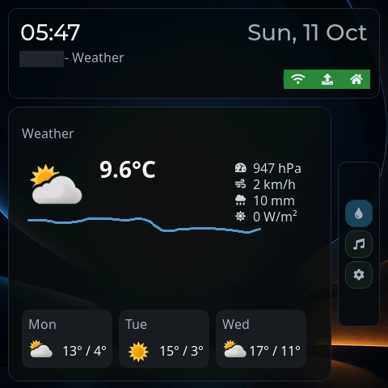
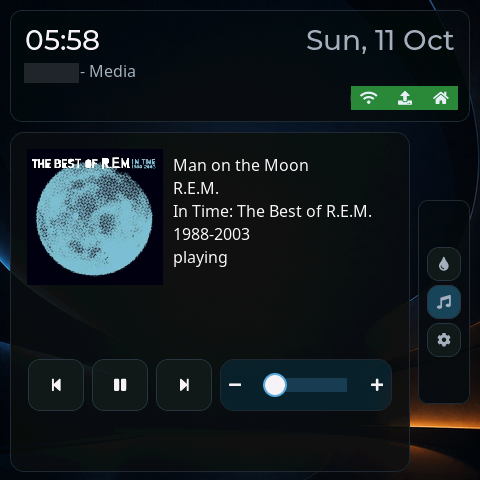
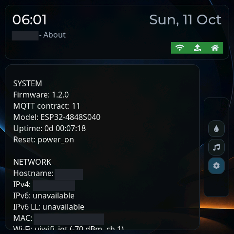

# Panel screenshots

Original 480×480 panel captures with opaque masks over only the device name, its hostname, and IP/MAC values. Page names, layout, timestamps, media content, weather values, and other diagnostics are unchanged. Every pixel outside these small masks is identical to the original BMP. File metadata is removed. Only the sanitized PNGs belong in version control; raw captures remain local.

## Weather

## Media

## About

To capture another enabled page, choose **Current Panel Page**, wait for rendering, and press **Capture Screenshot**. Download the default `/screenshot.bmp` with bearer authentication, or use the integration's **Panel Screenshot** preview. See the [main README](../../README.md) for capture and preview configuration. Review and redact any identifying text and remove file metadata before publishing a replacement. The named documentation PNGs are allowlisted in `.gitignore`; root-level BMP captures and other generated captures in this directory stay ignored.
